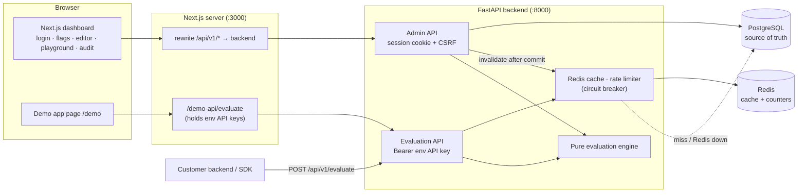
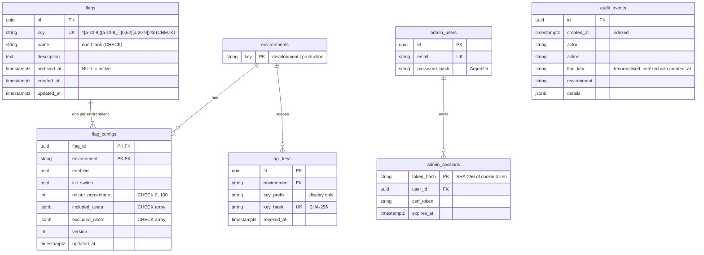
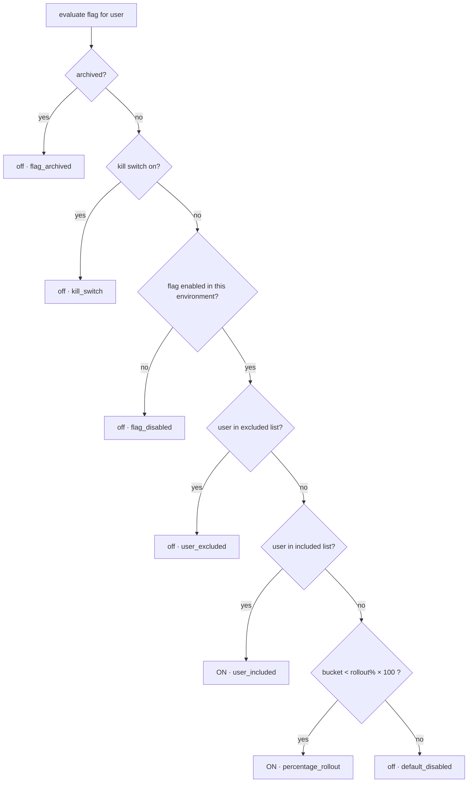
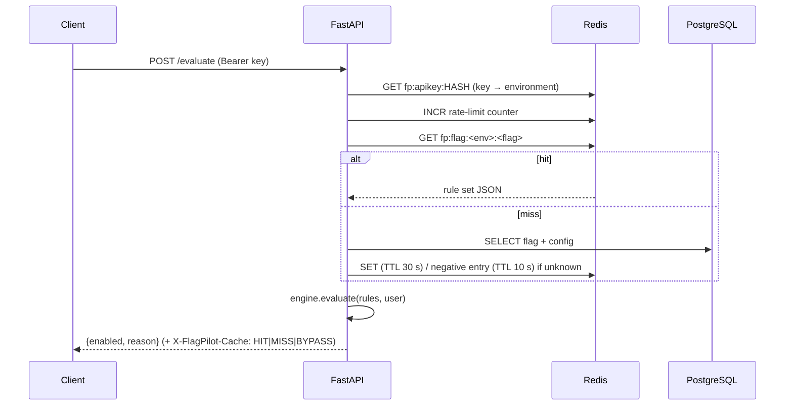
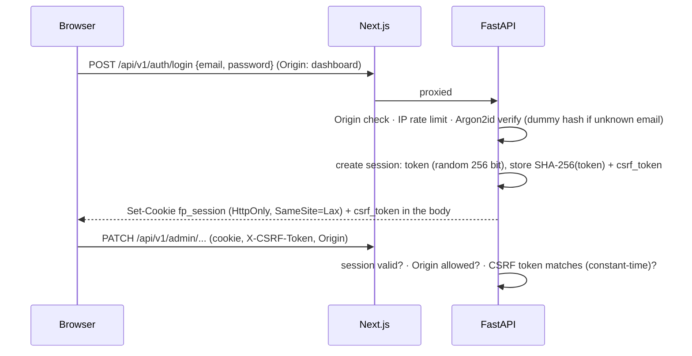

# FlagPilot — Architecture

This document explains how FlagPilot works and *why* it is built this way. It is written so that a recent CS graduate can use it to explain the design in a backend interview.

## 1. System overview



**Two kinds of callers, two kinds of credentials**

| Caller | Credential | Endpoints | Why separate |
|---|---|---|---|
| Dashboard administrator | HttpOnly session cookie + `X-CSRF-Token` + Origin check | `/api/v1/auth/*`, `/api/v1/admin/*` | Human, browser-based, state-changing → needs CSRF protection |
| Application evaluating flags | `Authorization: Bearer fpk_<env>_…` (hashed in DB, bound to one environment) | `POST /api/v1/evaluate` | Machine-to-machine, no cookies, cannot reach admin APIs, cannot cross environments |

### Frontend ↔ backend communication
The browser only talks to the Next.js origin. `next.config.ts` rewrites `/api/v1/*` to the FastAPI service. Because the session cookie is set on the Next.js origin, it is **same-origin** (no CORS/third-party-cookie problems), and the evaluation API keys used by the demo page never reach the browser: the demo's server route (`/demo-api/evaluate`) calls the backend with the key from its own environment and only allows three demo flags.

## 2. PostgreSQL schema



Design notes
* **One `flag_configs` row per (flag, environment)** with a composite primary key: environments are *physically separate rows*, so changing one can never modify the other. Both rows are created in the same transaction as the flag.
* **Constraints live in the database, not only in Pydantic**: key format, rollout 0–100, JSON arrays, unique keys, FKs. The test suite inserts bad data directly with SQL to prove the database refuses it.
* Environments are a seeded lookup table (natural key) rather than an enum so adding "staging" later is a data change plus a Pydantic literal, not a type migration.
* `audit_events.flag_key` is denormalised on purpose: history must survive even if flags were ever removed.
* Secrets (API keys, session tokens) are stored only as SHA-256 hashes. These are 256-bit random values, so a fast hash is appropriate (unlike passwords, which use Argon2id).

## 3. Evaluation algorithm

Implemented in `backend/app/engine/evaluator.py` as a **pure function** (`evaluate(rules, user_id)`): no database, cache or clock, so it is trivially unit-testable (32 tests).

### Precedence (first match wins)

Unknown flag → `off · flag_not_found` (decided before the engine is called).

### Deterministic bucketing
```
bucket = int.from_bytes(SHA256(flag_key + 0x1F + environment + 0x1F + user_id)[:8], "big") mod 10000
in_rollout = bucket < rollout_percentage * 100
```
* **Deterministic and process-independent**: SHA-256, not Python's `hash()` (which is randomised per process via `PYTHONHASHSEED`). A test runs the function in subprocesses with different hash seeds.
* **Per flag *and* environment**: including the flag key means the same unlucky users aren't always first in every rollout; including the environment makes dev and prod roll out independently.
* **`0x1F` separator** prevents ambiguity such as `("ab","c")` vs `("a","bc")`.
* **Monotonic**: a user is in iff `bucket < pct*100`, so raising the percentage only ever *adds* users; nobody who already had the feature loses it (tested over 5 000 users and steps of 5 %).
* **0 % and 100 % are exact**: buckets are in `[0, 10000)`, so 0 → nobody, 100 → everybody.
* Modulo bias is ~10⁻¹⁵ (2⁶⁴ vs 10⁴), irrelevant.
* Resolution is 0.01 % internally even though the API accepts whole percentages.

## 4. Redis caching strategy



* **What is cached:** the *rule set* per (environment, flag), not per-user answers, so cache size is O(flags), evaluated user ids are never stored, and one entry serves every user.
* **Cache-aside + TTL + explicit invalidation.** Admin writes commit to PostgreSQL **first**, then `DEL` the affected key(s) (only the environment that changed; create/archive/restore clear both). Every entry also has a TTL (30 s default), so even a *lost* invalidation can leave stale data for at most one TTL.
* **Negative caching** (10 s) protects the database from typo/probe floods; creating a flag invalidates its negative entry.
* **Known race (documented trade-off):** a reader that loaded old data from PostgreSQL *before* a writer commits can `SET` it *after* the writer's `DEL`. The TTL bounds this to ≤ 30 s. Using versioned keys would remove it at the cost of extra complexity; for this project correctness is bounded rather than absolute.
* **Redis failures** go through a **circuit breaker** (`RedisGuard`): on the first error it opens for 5 s, during which Redis calls are skipped instantly (no per-request timeout penalty) and the API answers from PostgreSQL (`X-FlagPilot-Cache: BYPASS`; `/health/ready` reports `degraded`). After the cooldown the next request probes Redis (half-open) and closes the circuit on success.
* **Recovery hook:** invalidations skipped during an outage could leave stale entries in a Redis that comes back with its data intact. On recovery the guard runs a hook that deletes every `fp:flag:*` and `fp:apikey:*` key, so nothing stale outlives the outage. Tested explicitly.
* Rate-limit counters use Redis `INCR`+`EXPIRE` (fixed window). If Redis is down, an in-process counter keeps enforcing limits (per worker).

## 5. Authentication and security model



* **Admin account:** one account from `ADMIN_EMAIL`/`ADMIN_PASSWORD` (environment), hashed with Argon2id at startup. Changing the env value and restarting updates the hash. No registration.
* **Sessions:** server-side, hashed token in PostgreSQL, 12 h expiry, deleted on logout, so a stolen cookie dies at logout (tested), unlike stateless JWTs.
* **CSRF:** `SameSite=Lax` cookie *plus* a per-session CSRF token header *plus* a strict `Origin` allow-list on every unsafe method (the Origin header is required).
* **API keys:** `fpk_<environment>_<256-bit random>`; shown once; hashed; bound to one environment; revocation is immediate (the key cache entry is deleted).
* **Evaluation clients can't reach admin APIs and vice versa.**
* **Brute force / abuse:** login limited per client address (10/min default; behind the bundled Next.js proxy this is one shared bucket, see Known limitations), evaluation limited per API key (600/min default), repeated invalid API keys throttled per IP before any DB lookup, admin API limited per session.
* **Safe errors:** every error is `{"error": {code, message, request_id}}`; validation errors strip submitted values; unhandled exceptions produce a generic 500. Logs are structured JSON and contain request metadata only (a test greps logs for credentials).
* **Input validation** with Pydantic (`extra="forbid"`), parameterized ORM queries only (search input has `LIKE` wildcards escaped), security headers, strict CORS allow-list with credentials.

### Known limitations
* Single administrator and no password reset; this is a demo-grade auth scope.
* **Client IP and `X-Forwarded-For`:** the Next.js rewrite proxy forwards the client-supplied header unchanged and never adds the real peer, so the header is attacker-controlled. The API therefore ignores it by default (`TRUSTED_PROXY_HOPS=0`) and rate-limits by TCP peer; behind the bundled proxy every dashboard login shares one bucket (spoof-proof, but a login flood can lock the admin out for up to a minute). With `TRUSTED_PROXY_HOPS=N` the API uses the N-th entry from the right (the one a real trusted proxy appended), never the left-hand entries. (An earlier version trusted the first entry; that allowed bypassing the login limit and was fixed.)
* Redis has no password and Compose binds PostgreSQL, Redis and the API to `127.0.0.1`; `/docs` is public. Do not publish these ports unmodified.
* No TLS termination (`COOKIE_SECURE=true` must be set behind HTTPS).
* Targeting is by exact user-id lists; no attribute rules or segments by design.
* Rollout percentage is a whole number; no gradual/scheduled rollouts.
* Fixed-window rate limiting allows short bursts at window boundaries.
* The audit log records admin changes, not individual evaluations.

## 6. API request flow (evaluate)
1. `require_api_key`: parse `Authorization`, SHA-256 the key, look it up in Redis then PostgreSQL, enforce per-key rate limit → resolves the **environment** (the request body cannot choose one: `environment` is rejected as an unknown field).
2. Validate body (`flag_key`, `user_id`).
3. `EvaluationService.load_rules`: Redis → PostgreSQL fallback → populate cache.
4. `engine.evaluate` → response `{flag_key, enabled, reason, environment}`.

## 7. Failure handling

| Failure | Behaviour | Health |
|---|---|---|
| Redis down | Everything keeps working from PostgreSQL; rate limiting falls back to in-memory; no added latency (circuit open) | `/health/ready` → 200 `degraded` |
| Redis returns | Probed after cooldown; flag cache purged; normal service | `ok` |
| PostgreSQL down, answer cached | Evaluation served from Redis (API key + rules both cached) | 503 `unavailable` |
| PostgreSQL down, not cached | `503 database_unavailable` + `Retry-After`, no stack trace. **Clients should fail closed** (treat the flag as off) | 503 |
| Unknown flag | `200 enabled=false reason=flag_not_found` | — |
| Archived flag | `200 enabled=false reason=flag_archived` | — |
| Bad / revoked API key | `401` | — |
| Too many requests | `429` + `Retry-After` | — |

*Healthy* means PostgreSQL and Redis both respond. *Degraded* means correct but slower and with weaker rate limiting (Redis lost). *Unavailable* means the platform can't serve requests that need PostgreSQL.

## 8. Important trade-offs
* **Sync SQLAlchemy + threadpool** instead of async: simpler to reason about and test; the hot path is I/O to two local services, and horizontal scaling is by replicas.
* **Cache rule sets, not answers:** smaller cache, no user data in Redis, one invalidation covers everyone.
* **TTL + invalidation, not only one of them:** invalidation gives immediacy, TTL gives a hard staleness bound.
* **503 on evaluation failure, not a fake "off":** an outage must be visible to callers/monitoring; callers decide their default (documented: fail closed).
* **DB-backed sessions:** one extra lookup per admin request in exchange for real logout and revocation.
* **Fixed percentages over a hashed bucket** rather than random assignment or stored per-user assignments: stateless, reproducible, and monotonic.
