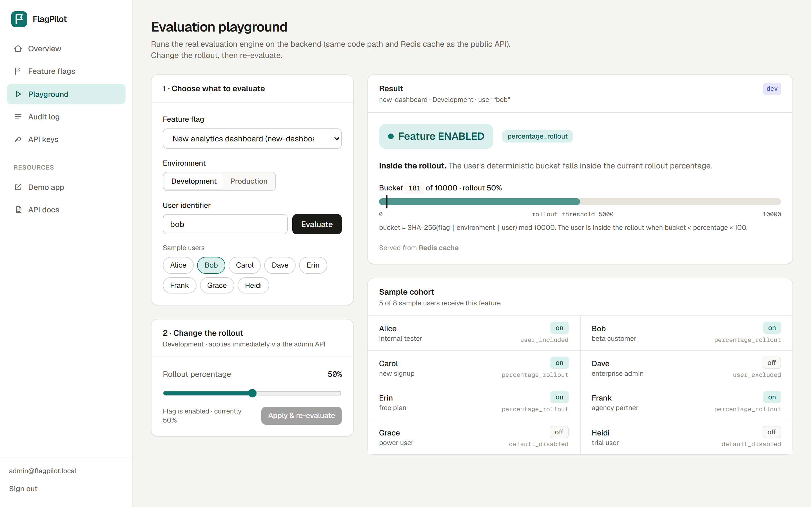
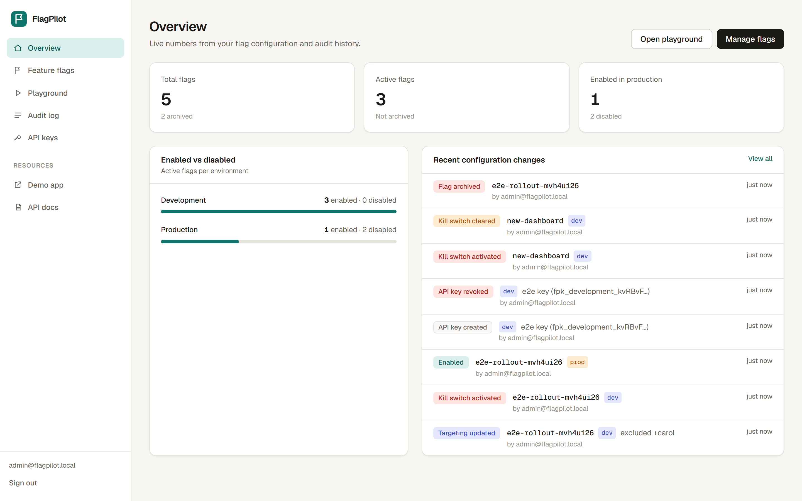
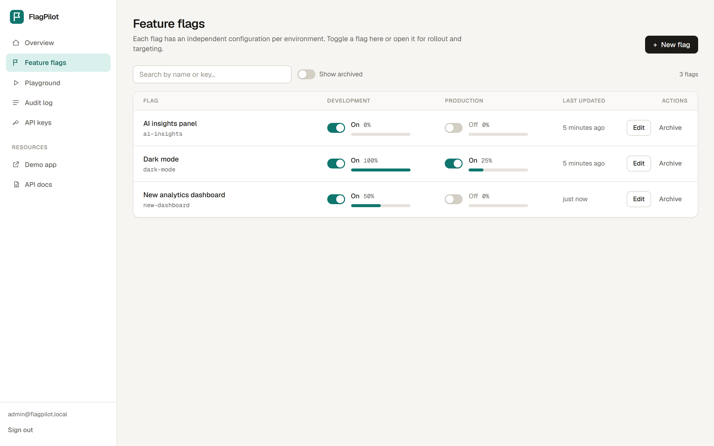
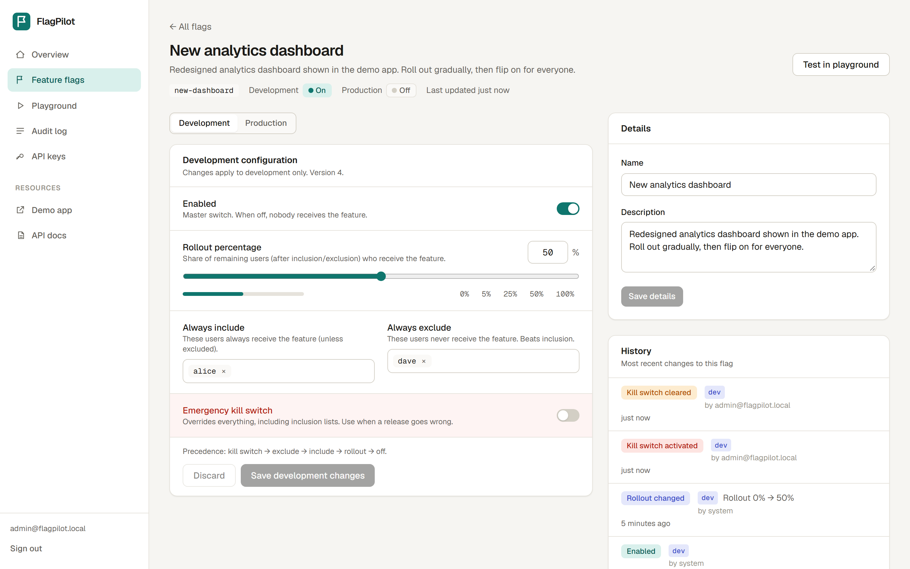
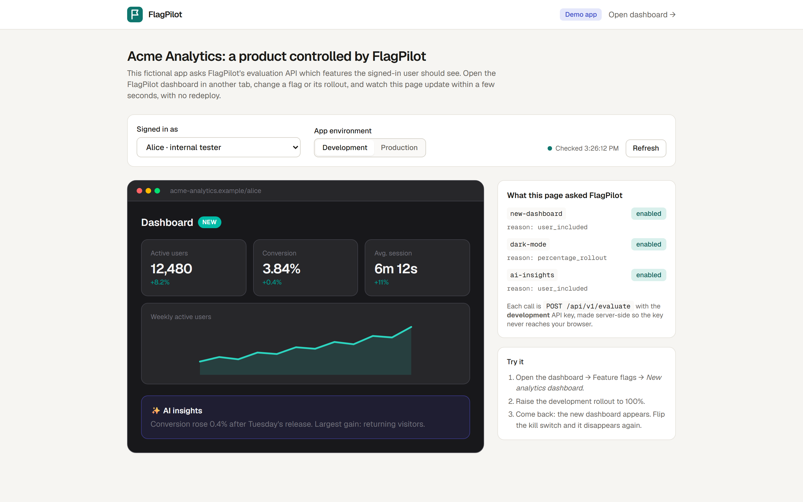
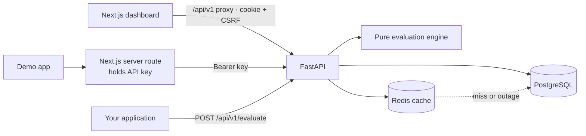

# FlagPilot

**A self-hosted feature flag platform: roll features out to a percentage of users, target specific people, keep development and production independent, and flip a kill switch, all without redeploying.**



## The problem

Releasing a new feature to every user at once is risky. Teams need to turn functionality on or off remotely, release it to 5 % of users and then 50 %, try it with their own testers first, keep production dark while development is open, shut a bad release off in seconds, and know who changed what. FlagPilot provides a dashboard and an API for exactly that: a developer creates `new-dashboard`, enables it for 20 % of users, checks who gets it, raises it to 50 % or disables it, and the consuming application sees the change on its next call.

## Features

* **Flag management**: create, edit, enable/disable, archive/restore; unique immutable keys; validation and database constraints.
* **Two independent environments** (development, production): separate configuration rows and separate API keys.
* **Deterministic percentage rollouts**: SHA-256 bucketing; the same user always gets the same answer; raising the percentage never removes anyone.
* **User targeting**: always-include / always-exclude lists, with documented precedence: kill switch → disabled → exclude → include → rollout → default off.
* **Evaluation API** authenticated by environment-scoped, hashed API keys, separate from dashboard sessions.
* **Redis cache** with TTL, invalidation on every change, circuit breaker and automatic recovery; PostgreSQL stays the source of truth.
* **Rate limiting**, CSRF + Origin checks, Argon2id password hashing, HttpOnly session cookies, safe error bodies, no secrets in logs.
* **Audit history** of every administrative change.
* **Dashboard**: overview, flags table with quick toggles, flag editor, **evaluation playground** (calls the real backend), audit log, API key management.
* **Demo app** (`/demo`): a fictional product whose UI changes live when you change a flag.

### Screenshots

| Overview | Feature flags |
|---|---|
|  |  |
| **Flag editor** | **Demo app driven by FlagPilot** |
|  |  |

## Technology

Python 3.12 · FastAPI · SQLAlchemy 2 · Alembic · Pydantic v2 · PostgreSQL 16 · Redis 7 · Next.js 15 (App Router) · TypeScript · Tailwind CSS 4 · Docker Compose · pytest · Vitest · Playwright.

## Architecture



Full design, schema, algorithm, caching and failure handling: **[ARCHITECTURE.md](ARCHITECTURE.md)**.

## Getting started

Prerequisites: **Docker Desktop** (Compose v2) and **Python 3** (only to generate the `.env` file). Nothing else is installed on your machine.

```bash
python scripts/setup.py          # creates .env with freshly generated secrets (git-ignored) and prints the demo login
docker compose up --build -d     # PostgreSQL, Redis, backend, frontend (first build takes a few minutes)
```

| What | URL |
|---|---|
| Dashboard | http://localhost:3000 |
| Public demo app | http://localhost:3000/demo |
| API docs (OpenAPI/Swagger) | http://localhost:8000/docs |
| Health | http://localhost:8000/health/ready |

### Demo credentials

No credentials are committed. `scripts/setup.py` generates `.env` containing a random administrator password; run `python scripts/setup.py --show` at any time to print the email and password. To choose your own, edit `ADMIN_EMAIL` / `ADMIN_PASSWORD` in `.env` and run `docker compose up -d backend` (the hash is updated on startup). On first start the app also seeds three demo flags (`new-dashboard`, `dark-mode`, `ai-insights`) and one API key per environment (values in `.env`).

Stop with `docker compose down` (add `-v` to delete the database volume).

## API examples

```bash
# Evaluate a flag (environment is determined by the key). Keys are in .env: BOOTSTRAP_API_KEY_DEVELOPMENT / _PRODUCTION
curl -X POST http://localhost:8000/api/v1/evaluate \
  -H "Authorization: Bearer $FLAGPILOT_KEY" -H "Content-Type: application/json" \
  -d '{"flag_key": "new-dashboard", "user_id": "alice"}'
# {"flag_key":"new-dashboard","enabled":true,"reason":"user_included","environment":"development"}
```

| Reason | Meaning |
|---|---|
| `flag_disabled` / `kill_switch` | Off in this environment / emergency override |
| `user_excluded` / `user_included` | Explicit targeting |
| `percentage_rollout` | Bucket is inside the rollout |
| `default_disabled` | No rule matched |
| `flag_not_found` / `flag_archived` | Unknown or archived flag: `200`, `enabled=false` |

Errors use `{"error": {"code", "message", "request_id"}}`: `401` bad/revoked key, `422` invalid body, `429` rate limited (`Retry-After`), `503` evaluation unavailable. **Clients should fail closed (treat the flag as off) on any non-200.** Responses include `X-FlagPilot-Cache: HIT|MISS|BYPASS`.

Admin endpoints (`/api/v1/admin/*`) need a session cookie from `POST /api/v1/auth/login`, plus `Origin` and `X-CSRF-Token` headers on writes; see `/docs`.

## Testing

```powershell
# Backend: unit + integration against REAL PostgreSQL and Redis (compose services must be running)
cd backend; python -m venv .venv; .\.venv\Scripts\pip install -r requirements-dev.txt
.\.venv\Scripts\python -m pytest -q
$env:FLAGPILOT_LIVE_URL="http://127.0.0.1:8000"; .\.venv\Scripts\python -m pytest tests/test_live_stack.py   # also hit the running containers

# Frontend
cd frontend; npm install
npm run typecheck; npm run lint; npm test; npm run build
npx playwright install chromium; npm run e2e      # needs the full stack running
npm run screenshots                                # regenerates portfolio/screenshots

# Benchmark (raise the rate limit first, restore afterwards)
$env:EVAL_RATE_LIMIT="1000000"; docker compose up -d backend
backend\.venv\Scripts\python benchmarks\bench_evaluate.py
```

Results and exact environment: **[TEST_REPORT.md](TEST_REPORT.md)** (192 backend tests, 9 frontend unit tests, 11 browser end-to-end tests at the time of writing).

## Engineering decisions

* **The evaluation engine is a pure function**: easy to test exhaustively (32 unit tests) and independent of storage.
* **SHA-256 bucket over `flag + environment + user`**: stateless, reproducible across processes and languages, monotonic when raising a rollout.
* **Redis caches rule sets, not user answers**; PostgreSQL commit first, then invalidate; TTL as a staleness ceiling; circuit breaker so a dead Redis costs no latency.
* **Evaluation failure returns 503**, not a silent "off", so outages are visible; unknown flags return a documented safe default instead.
* **Server-side sessions + CSRF + Origin checks** rather than JWTs in local storage; API keys are hashed and environment-bound.
* **Next.js proxies the API** so cookies are same-origin and the demo app's API keys never reach the browser.
* **Constraints in the database** as well as in Pydantic, proven by tests that bypass the API.

## Known limitations

* Demo-grade auth: one administrator, no password reset, no TLS termination (set `COOKIE_SECURE=true` behind HTTPS).
* Exact user-id targeting only; whole-number percentages; two fixed environments.
* A bounded (≤ TTL, default 30 s) stale-cache window exists in a rare read/write race and after lost invalidations (see ARCHITECTURE.md §4).
* Rate limiting is a fixed window; the Redis-down fallback is per process.
* `X-Forwarded-For` is ignored by default (`TRUSTED_PROXY_HOPS=0`) because the bundled Next.js proxy forwards the client-supplied header unchanged. Consequence: dashboard logins share one rate-limit bucket (10/min), so a flood of failed logins can briefly lock the admin out. Set `TRUSTED_PROXY_HOPS` only when a real proxy (nginx, a load balancer) appends the client address.
* The backend, PostgreSQL and Redis ports are bound to `127.0.0.1` only; Redis has no password and `/docs` + `/openapi.json` are public. Do not expose these ports to a network as-is.
* Local benchmark numbers are single-machine comparisons, not capacity claims.
* `npm audit` still reports 7 advisories (Next's bundled PostCSS needs a Next 16 major upgrade; the rest is ESLint dev tooling). `sharp` was patched and the unused `/_next/image` endpoint is disabled. Details in TEST_REPORT.md.
* Only Chromium was used for browser tests.

## Project layout

```
backend/    FastAPI app (api, services, repositories, engine, cache, auth), Alembic migrations, pytest suite
frontend/   Next.js dashboard, playground, demo app, Vitest + Playwright (e2e/)
benchmarks/ evaluation benchmark
scripts/    setup.py (secret generation)
portfolio/  screenshots
```

Project docs: [CLAUDE.md](CLAUDE.md) · [IMPLEMENTATION_PLAN.md](IMPLEMENTATION_PLAN.md) · [PROGRESS_STATUS.md](PROGRESS_STATUS.md) · [ARCHITECTURE.md](ARCHITECTURE.md) · [TEST_REPORT.md](TEST_REPORT.md) · [PORTFOLIO_SUMMARY.md](PORTFOLIO_SUMMARY.md)

*FlagPilot was designed independently; GO Feature Flag and Flagsmith were studied conceptually only. No code, branding or assets were copied.*
